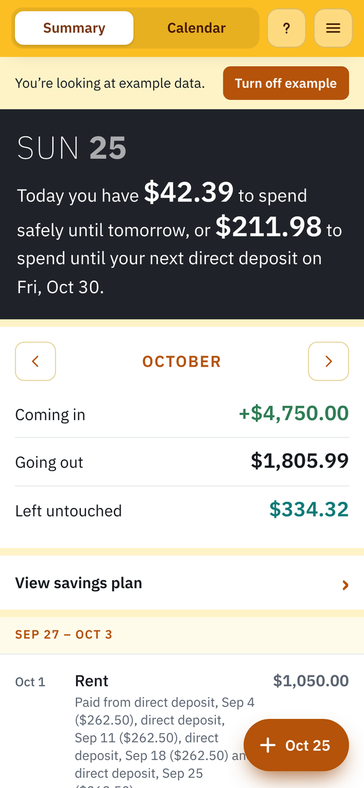
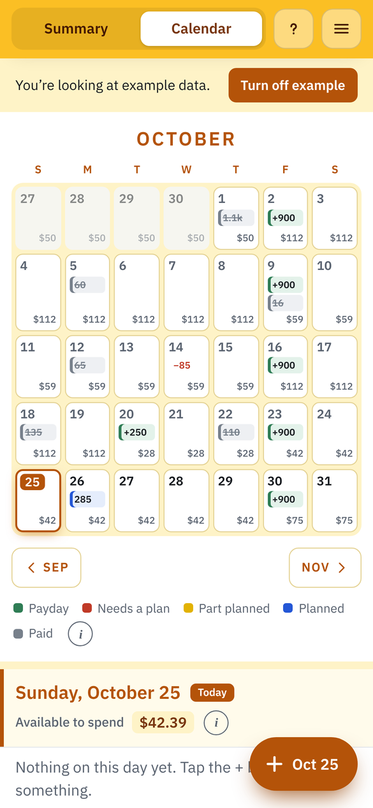
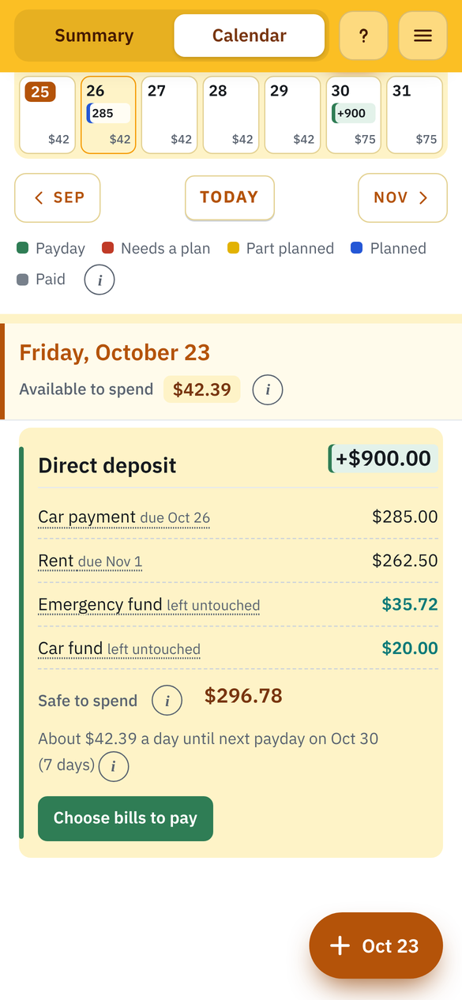

# Payday Planner

**Try it:** https://bjessief-apps.github.io/Payday-Planner/ (tap "See an example" to look around)

I wanted to stop guessing whether I could afford something before my next check came in. Payday Planner lines up each paycheck with the bills it has to cover and tells you what's actually safe to spend today.

<table>
  <tr>
    <td align="center"> Safe to spend today</td>
    <td align="center"> Every day's spending money</td>
    <td align="center"> Where each check goes</td>
  </tr>
</table>

Screenshots show the app's built-in example month, not real money.

**Payday Planner is for tracking, mapping and planning your money.** It's interactive and depends on your real money moves: paydays, bills you pay, surprise expenses. It never connects to your bank and only knows what you tell it, so if it isn't updated, its numbers won't match your real money. The only set-and-forget parts are the ones you've automated in your bank apps, like automatic transfers or autopay.

It plans which paycheck covers each bill and shows how much is safe to spend each day until your next payday. It's built for structured, safer spending and works for simple or messy money setups.

## What it does

- **Summary** opens first: today's date and what's safe to spend today and until your next deposit, the month's money coming in and going out, and each Sunday–Saturday week laid out by date.
- **Calendar** with every payday, bill and unexpected expense, plus each day's safe-to-spend amount. Swipe between Summary and Calendar; each page keeps your spot.
- **Plans bills on its own.** Each bill takes money from the nearest paycheck before its due date and spills into earlier paychecks when one isn't enough. You can also split a bill across paychecks by hand.
- **One + button** that shows the day it adds to: income of any kind, bills, subscriptions, unexpected expenses and savings goals.
- **Savings goals** leave part of each deposit untouched (by a date, a set amount or a percent).
- **Twelve color themes** that can change with the month, plus light and dark mode (match your phone, or pick one).
- An example month to explore, an activity log, undo, backup and restore, and hints.

## Setup

None. It's one self-contained file with no accounts, API keys or outside services. The font is built in, so it works offline.

## Your data

Everything you enter is saved only in your own browser on your own device. Nothing is sent anywhere, and visitors to this site can't see your planner. Use the backup options in the ☰ menu to move it to another browser or device.

## Running locally

Download `index.html` and open it in any browser.

## Credits

Font: IBM Plex Sans by IBM, under the SIL Open Font License 1.1.
